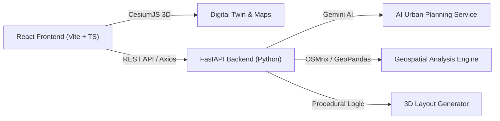

# 🧭 Urban Compass

> **AI-Powered Urban Planning & 3D Geospatial Intelligence Platform**

Urban Compass is a modern geospatial intelligence and generative urban planning application. It bridges the gap between raw GIS data and actionable urban design by combining **multi-criteria land suitability analysis (MCDA)**, **Google Gemini AI urban planning**, and an interactive **CesiumJS 3D digital twin**.

---

## 🌟 Key Features

### 🌐 Interactive 3D Geospatial Digital Twin
- **High-Resolution 3D Terrain**: Powered by Cesium World Terrain and global elevation models.
- **Multi-Layer Base Maps**: Toggle between Google Satellite, Google Hybrid labels, and terrain elevation.
- **3D City & Building Rendering**: Dynamic OpenStreetMap (OSM) 3D buildings alongside custom procedural GLTF/GLB architectural models (residential, commercial, industrial, civic).
- **Precision Area Measurement**: Draw custom polygons, circles, or bounding boxes with real-time acreage, square meters, perimeter, and elevation profiling.

### 📊 Multi-Criteria Decision Analysis (MCDA)
- **Slope & Topography**: Elevation variation, terrain slope feasibility, and runoff risk evaluation.
- **Vegetation & Hydrology**: Remote sensing indices (NDVI / NDWI) for environmental impact and flood risk assessment.
- **Infrastructure & Connectivity**: OSM road network density auditing, distance to primary transit corridors, and site accessibility scoring.
- **Composite Suitability Score**: Weighted multi-factor classification (0–100%) indicating optimal land use.

### 🤖 AI Urban Planner (Gemini-Powered)
- **Constraint-Aware Population Capacity**: Calculates realistic population ceilings respecting topography, accessibility, and environmental constraints.
- **Zoning & Density Distribution**: Algorithmic land allocation for residential, commercial, industrial, civic, and green spaces.
- **Public Infrastructure Estimations**:
  - Educational facilities (1 per 3,000 residents)
  - Healthcare centers & hospitals (1 per 25,000 residents)
  - Emergency services (police and fire stations)
  - Parks, public gardens, and open plazas
- **Utility & Resource Modeling**: Daily demands for potable water, electricity (kWh), wastewater processing, and solid waste output.
- **Economic Projections**: Estimated construction expenditures, job creation capacity, annual municipal tax revenue, and projected ROI.

### 🏙️ Procedural 3D City Builder
- **Generative Layout Engine**: Converts AI-generated zoning and density distributions into placed 3D building models directly on the terrain.
- **Custom 3D Assets**: High-fidelity GLB models for schools, hospitals, apartments, single-family homes, offices, factories, and parks.
- **Live Inspection**: Click-to-inspect individual structures, modify density parameters, and re-simulate in real time.

---

## 🏗️ Architecture & Tech Stack



| Layer | Technologies |
| :--- | :--- |
| **Frontend** | React 18, TypeScript, Vite, Tailwind CSS, shadcn/ui, Radix UI, Zustand, Lucide React, Recharts |
| **3D & Maps** | CesiumJS, Turf.js, Google Maps Platform (Satellite & Tiles API), Git LFS (GLB/GLTF models) |
| **Backend** | Python 3.10+, FastAPI, Uvicorn, Pydantic, Google Generative AI (Gemini) |
| **Geospatial** | GeoPandas, Shapely, OSMnx, Rasterio, NumPy, SciPy |

---

## 🚀 Quick Start

### Prerequisites
- **Node.js**: v18.0 or higher
- **Python**: v3.10 or higher
- **Git LFS**: Installed (`git lfs install`)

### 1. Clone the Repository
```bash
git clone git@github.com:Punit0007x/Urban_Compass.git
cd Urban_Compass
git lfs pull
```

### 2. Configure Environment Variables

#### Frontend (`.env` in root)
Copy the example file and add your API tokens:
```bash
cp .env.example .env
```
Fill in:
```env
# Cesium Ion Access Token (https://cesium.com/ion/)
VITE_CESIUM_ION_TOKEN=your_cesium_ion_token

# Google Maps API Key (Maps JavaScript API, Places API, Geocoding)
VITE_GOOGLE_MAPS_API_KEY=your_google_maps_api_key

# Backend API URL
VITE_API_BASE_URL=http://localhost:8000
```

#### Backend (`backend/.env`)
Copy the backend example file:
```bash
cp backend/.env.example backend/.env
```
Fill in:
```env
PORT=8000
HOST=0.0.0.0
DEBUG=True
ENVIRONMENT=development

# Google Gemini API Key (https://aistudio.google.com/)
GEMINI_API_KEY=your_gemini_api_key
```

---

### 3. Running the Application

#### Option A: One-Command Startup (Recommended)
You can start both the FastAPI backend and Vite frontend simultaneously:

**Using Python:**
```bash
python3 start_all.py
```

**Or using Bash:**
```bash
chmod +x start-dev.sh
./start-dev.sh
```

#### Option B: Manual Setup

**Terminal 1 — Backend:**
```bash
cd backend
python3 -m venv venv
source venv/bin/activate       # On Windows: venv\Scripts\activate
pip install -r requirements.txt
python3 main.py
```
*Backend runs on `http://localhost:8000` (Swagger docs available at `http://localhost:8000/docs`).*

**Terminal 2 — Frontend:**
```bash
npm install
npm run dev
```
*Frontend runs on `http://localhost:8080`.*

---

## 📁 Project Structure

```text
urban_compass/
├── backend/                        # FastAPI Backend Application
│   ├── app/
│   │   ├── api/                    # API endpoints (analysis, health, planning)
│   │   │   └── analysis.py
│   │   └── services/               # Core backend services
│   │       ├── ai_service.py       # Gemini AI urban planner
│   │       ├── geo_service.py      # Spatial metrics (slope, NDVI, roads)
│   │       ├── layout_generator.py # Procedural 3D building placements
│   │       └── urban_planner_service.py # Constraint calculations
│   ├── main.py                     # FastAPI entry point
│   └── requirements.txt            # Python dependencies
│
├── public/                         # Static assets & 3D models
│   ├── 3d-models/                  # GLTF/GLB models & textures
│   │   ├── city/                   # Standard city model
│   │   ├── city_3d_model/          # Detailed urban scan
│   │   └── city_mapnot_a_scan/     # Regional terrain model
│   └── models/buildings/           # Individual building GLB assets
│
├── src/                            # React Frontend Source
│   ├── components/                 # UI & Viewer components
│   │   ├── AnalysisBuilderPage.tsx # Land suitability analysis studio
│   │   ├── CesiumViewer.tsx        # CesiumJS 3D map canvas & camera controls
│   │   ├── CityBuilderPage.tsx     # Generative AI city planner view
│   │   ├── ControlPanel.tsx        # Layer and visualization toggles
│   │   └── CoordinateSearch.tsx    # Location geocoding & search
│   ├── lib/                        # Core client-side algorithms
│   │   ├── ai-city-planner.ts      # Client-side planning calculations
│   │   └── procedural-city.ts      # Grid & placement generators
│   ├── pages/                      # Page views (Index, LandAnalysis)
│   ├── services/                   # API clients and React Query hooks
│   └── store/                      # Zustand state stores
│
├── .env.example                    # Frontend environment template
├── .gitattributes                  # Git LFS tracking configuration
├── .gitignore                      # Git ignore rules
├── start_all.py                    # Unified orchestrator script
├── start-dev.sh                    # Unified shell runner
└── vite.config.ts                  # Vite build & proxy configuration
```

---

## 📡 API Reference

| Method | Endpoint | Description |
| :--- | :--- | :--- |
| `GET` | `/health` | Service health status |
| `POST` | `/api/v1/analyze-area` | Calculates geometric properties (Area, BBox, Centroid) |
| `POST` | `/api/v1/analyze-slope` | Computes elevation variation and terrain slope angles |
| `POST` | `/api/v1/analyze-vegetation` | Multi-spectral vegetation (NDVI) & water (NDWI) indices |
| `POST` | `/api/v1/analyze-road-connectivity` | Road network accessibility audit via OpenStreetMap |
| `POST` | `/api/v1/analyze-suitability` | Composite Multi-Criteria Decision Analysis (MCDA) score |

Interactive documentation is available at `http://localhost:8000/docs` when the backend is running.

---

## 📄 License

This project is licensed under the MIT License - see the LICENSE file for details.
